<picture>
  <source media="(prefers-color-scheme: dark)" srcset="./assets/source-dark.svg" />
  
</picture>

```ts
const tejashwini: Engineer = {
  name: "TEJASHWINI M",
  role: "Business Systems Analyst | Business Analyst",
  company: "Abbott Laboratories",
  location: "Lake Bluff, IL",
  yearsShipping: 5,
  languages: ["SQL", "Python", "Go", "TypeScript", "HTML", "JavaScript"],
  stack: ["Advanced Excel", "Power BI", "Tableau", "DAX", "Power Query", "SQL Server", "SSRS", "Postman"],
  focus: "Analyzing knowledge repositories and SOPs at Abbott Laboratories",
  career: [
    { at: "Abbott Laboratories", role: "Knowledge Management Analyst", when: "2026 – Present" },
    { at: "DICEUS", role: "Business Systems Analyst", when: "2025 – 2026" },
    { at: "Mphasis", role: "Business Analyst", when: "2021 – 2023" },
  ],
  education: "Master’s in Information Systems Technology, University of North Texas, Denton, Texas",
};
```

## `projects.map(explain)`

<details>
<summary><code>projects.consentPath()</code> Clinical trial enrollment with PostgreSQL row-level security</summary>

A multi-site clinical trial enrollment application where authorization lives in PostgreSQL row-level security policies.

</details>

<details>
<summary><code>projects.controlMap()</code> SOC 2 evidence automation from GitHub, AWS, and HR systems</summary>

SOC 2 evidence automation that collects exports from GitHub, AWS, identity and HR systems, evaluates YAML controls, maps them to criteria and builds a hashed evidence package.

</details>

<details>
<summary><code>projects.cannibal()</code> Search cannibalization detector with multiple-testing correction</summary>

Search cannibalization detection that tests page pairs with multiple-testing correction.

</details>

<details>
<summary><code>projects.contextLens()</code> VS Code extension surfacing commit context at the source line</summary>

Engineers waste significant time re-deriving why code is written a certain way — the tribal knowledge lives in PR comments and commit messages disconnected from the source line they explain.

</details>

<details>
<summary><code>projects.passKeyD()</code> WebAuthn relying-party library with custom CBOR and COSE parsers</summary>

A Go WebAuthn/passkey relying-party library and server with its own CBOR and COSE parsers, a virtual authenticator, and a negative test for each verification check.

</details>

<details>
<summary><code>projects.squatWatch()</code> Offline typosquat and dependency-confusion detector with SARIF output</summary>

An offline detector for typosquats, dependency-confusion exposure and risky install hooks in npm and PyPI dependencies, with SARIF output for CI.

</details>

## `CHANGELOG.md`

### v4.0 · Abbott Laboratories

*Apr 2026 – Present*

- Reviewed **120+ knowledge assets** to identify outdated information, duplicate content, and process gaps across business and technology teams
- Gathered requirements from subject matter experts and process owners to structure business information through standardized taxonomies, metadata, naming conventions, and content ownership guidelines
- Developed and maintained SOPs, knowledge articles, FAQs, and process guides, coordinating reviews with content owners

### v3.0 · DICEUS

*Aug 2025 – Mar 2026*

- Elicited requirements through stakeholder interviews and process workshops, translating business needs into functional specifications, user stories, use cases, and acceptance criteria for application enhancements
- Documented BRDs, FRDs, business rules, and process flows while comparing AS-IS and TO-BE workflows to identify gaps and dependencies across **4 key business workflows**
- Validated application data with SQL and Excel, reconciling reporting discrepancies and investigating business-rule exceptions across **8 Agile sprints**

### v2.0 · Mphasis

*Jul 2021 – Aug 2023*

- Created BRDs, FRDs, user stories, acceptance criteria, business rules, and process flows supporting **5+ application enhancements** across business and technical teams
- Queried and validated business data using SQL and Excel, reconciling discrepancies across **10+ reporting datasets**
- Supported UAT by reviewing test scenarios, validating acceptance criteria, and tracking defects, maintaining traceability in Jira and Confluence

## `npm ls --depth=0`

<p align="center">
  
</p>

## `contact()`

[`email`](mailto:tejaswini.mykala@belvionus.com) · [`github`](https://github.com/tejashwinimmykala)

## Projects

- [realtime-stock-market-pipeline](https://github.com/tejashwinimmykala/realtime-stock-market-pipeline)
- [consentpath](https://github.com/tejashwinimmykala/consentpath) — A multi-site clinical trial enrolment app where authorisation lives in PostgreSQL row-level security policies, proved by a negative-authz test matrix over…
- [cannibal](https://github.com/tejashwinimmykala/cannibal) — Search cannibalisation detection that tests page pairs with multiple-testing correction, so the output is a short list of real competing pairs instead of…
- [controlmap](https://github.com/tejashwinimmykala/controlmap) — SOC 2 evidence automation that collects exports from GitHub, AWS, identity and HR systems, evaluates YAML controls, maps them to criteria and builds a hashed…
- [greenpulse-energy-monitoring](https://github.com/tejashwinimmykala/greenpulse-energy-monitoring) — AI-Powered Energy Management That Cuts Costs by 32%
- [contextlens](https://github.com/tejashwinimmykala/contextlens) — Engineers waste significant time re-deriving why code is written a certain way — the tribal knowledge lives in PR comments and commit messages disconnected…
- [passkeyd](https://github.com/tejashwinimmykala/passkeyd) — A Go WebAuthn/passkey relying-party library and server with its own CBOR and COSE parsers, a virtual authenticator, and a negative test for each verification…
- [squatwatch](https://github.com/tejashwinimmykala/squatwatch) — An offline detector for typosquats, dependency-confusion exposure and risky install hooks in npm and PyPI dependencies, with SARIF output for CI.
- [provenance-gate](https://github.com/tejashwinimmykala/provenance-gate) — A SLSA provenance verifier that checks attestations against policy, then rebuilds the artifact and diffs it to prove the binary came from the reviewed source.
- [admitly](https://github.com/tejashwinimmykala/admitly) — A Kubernetes validating and mutating admission webhook with CEL policies, Audit and Enforce modes, securityContext defaulting and cosign-style signature checks.
